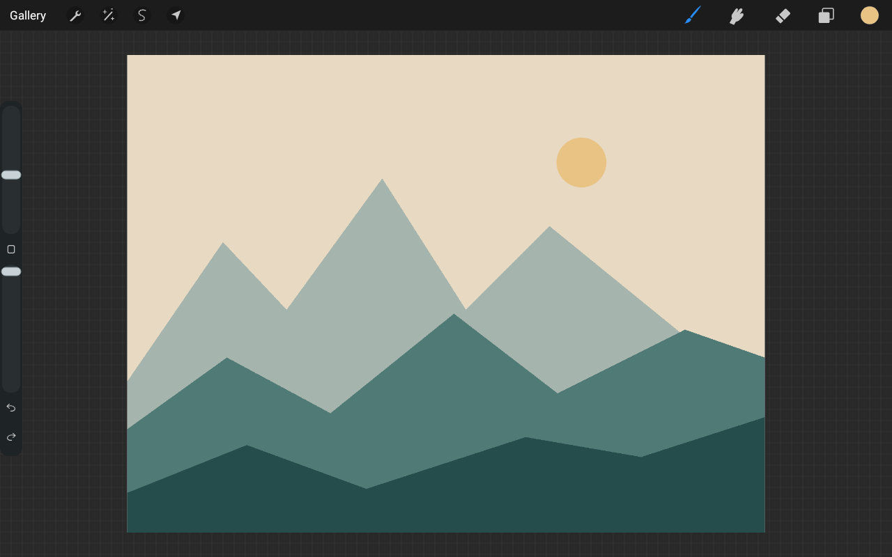

# Inkstone — Drawing for Android

Inkstone is a source-available drawing app for Android tablets and pressure-sensitive pens, built with a native Kotlin interface and a Rust drawing engine.

**Early development:** features are incomplete, bugs are expected, and more improvements are on the way. Vector mode is experimental. Keep exported backups of important artwork and share device feedback through [Issues](https://github.com/bramastahartono20/inkstone/issues).



**0.1.9-preview11 early-development release:** Canvas Atlas shares the editor workspace; Multicolor has an integrated dark settings panel with editable swatches, 13 visual tip choices and adjustable color cycles. Adds group blend/opacity, personal brush categories and independent panel sizing. Retains the contribution from [andikasujanadi in PR #1](https://github.com/bramastahartono20/inkstone/pull/1). See [release instructions and limits](docs/LOCAL_PREVIEW_019_11.md).

**Testing:** local regression/build checks are recorded in [verification](docs/VERIFICATION.md). Physical stylus behavior, Android Vulkan, animation pacing and device-reported Fade behavior still need testing. Current limitations are tracked in [known issues](docs/KNOWN_ISSUES.md).

## Download

Get the **[0.1.9-preview11 APK](https://github.com/bramastahartono20/inkstone/releases/tag/v0.1.9-preview11)** from GitHub Releases. Requires Android 8.0 or later; ARM64 and x86-64 are included. Enable installation from the app used to open the APK when Android asks.

The preview uses package `art.inkstone.preview`. Install over an existing preview to retain local artwork. Artwork lives in app-private storage: export editable `.inkstone` backups before uninstalling or clearing app data. No account, server, internet permission, analytics, or subscription is required.

## What you can try

- **Organize the gallery:** sort by name or dates, tag/filter artworks, and create named stacks with artwork counts. Hold an artwork and drop it into a stack card or the Drag to destinations. Use ⋯ for artwork options, or Select for bulk tags/stack changes.

- **Draw, smudge and erase:** 57 procedural presets, pressure controls, flow, stabilization and a global pressure toggle. Eraser has the same preset library, inverted previews and separate brush settings. Tap the Eraser icon to select it and open its library; the library's + button opens settings including edge hardness.
- **Canvas Atlas:** pinch out to browse nearby artwork in the same workspace. Pan, zoom and rotate; tap an artwork to activate drawing in place. Hold and drag overview artworks to arrange them. Inactive canvases use cached previews.
- **Multicolor and personal brushes:** open Brush Library → + → Brush Studio → Multicolor settings. Edit up to 12 colors, choose among 13 tip types, and adjust arrangement and cycle length. Save personal presets and categories from the library.
- **ColorDrop:** drag the active color into an enclosed area, pause for the fill preview, then slide left/right to adjust threshold. Release to commit in one Undo step. Color selection includes a wheel, a square picker, hex/RGB values and palettes. In Raster mode, drag the rectangular preview at the top of Colors onto the palette to save it. Open **Palette → + New palette** or **Palettes → New palette** to create a named palette; custom palettes stay saved across artworks and app restarts.
- **Layers:** add, rename, duplicate, reorder, lock, hide, adjust opacity, use alpha lock/clipping and fifteen blend modes. Indented folders support visibility/lock, collapse, group blend/opacity and animated layer drag/drop. Open a group’s blend/options button → Blend & opacity. Drag beyond a folder boundary to leave it. Swipe left on a layer for actions.
- **Select and transform:** Automatic/freehand/rectangle/ellipse selection, Add/Remove/Invert, Feather, saved selections, clipboard actions, and Freeform/Uniform/Distort/Warp transforms. The compact bottom toolbar groups tools and scrolls horizontally. Corner and edge handles, free rotation, flips and two-finger object transforms are supported. Inserted images enter Transform automatically. Tap Done to apply.
- **Pen and touch controls:** pen-only input, control palm protection, handedness, hover cursor, canvas-position lock, hold-to-shape fitting and gesture Undo/Redo.
- **Experimental Vector mode:** choose Vector when creating a canvas. Draw paths and shapes, edit anchors and direction handles, organize layers, and export real SVG. To bend a straight line, select it with Nodes, tap **+ Anchor**, tap between its endpoints, then drag the new point or its handles. Stroke stabilization is in Actions → Stroke settings.
- **Guides and Liquify:** perspective/isometric overlays with editable vanishing points in both editors; Raster Liquify with Push, Pinch, Expand, Twirl, Restore, Cancel and one-step Undo.
- **Responsive workspace:** shared Raster/Vector toolbar positions, docked size/opacity controls, portrait history controls, icon tooltips and animated panels.

### Saving and export

| Format | What it preserves |
|---|---|
| `.inkstone` | Editable project and layers; Raster pixels or Vector geometry |
| PNG | Flattened image, including transparency |
| JPG | Flattened image with a white background |
| PSD | Separate raster layers, names, opacity, visibility, clipping and blend metadata; 8-bit RGB |
| SVG | Vector paths, shapes, transforms and named layer groups; Vector mode only |

Use **Save** for project saving, Photo Gallery PNG/JPG output, or exports to a chosen folder. Groups with their own opacity or blend mode are baked to one PSD layer to preserve appearance; keep `.inkstone` for editable folder members. PSD exports from Vector mode rasterize each layer; keep `.inkstone` or SVG for editable vector geometry. The 0.1.8 preview imports supported 8-bit RGB layered PSDs. CMYK, editable smart objects and PSD vector shapes remain unavailable. See [export details](docs/EXPORT_FORMATS.md).

## Performance and limitations

The Rust engine uses `wgpu` compute for brush/eraser stamps, smudge and live layer compositing when a supported Vulkan adapter is available, with automatic CPU fallback. Choose a backend in **Actions → Prefs → Drawing renderer**. Bitmap presentation/readback, ColorDrop, adjustments and export still involve CPU work. This is a hybrid renderer; a tiled renderer and direct GPU presentation remain future work.

Canvas area is limited to 16 megapixels, with separate layer and history memory budgets. Large artwork can still consume substantial memory and export slowly. Sustained latency, thermals, pressure calibration and Vulkan driver behavior need further Android device testing. Vector mode currently lacks SVG import, text, boolean operations, gradients, tracing, multi-object selection and pressure-varying strokes. Text, time-lapse and animation are not available. Groups and gallery stacks have one level. Atlas layout, gallery metadata and personal brush libraries stay device-local. Experimental Wet mix is an approximate RYB model; physical pigment and thick-paint simulation are not included. Raster Warp uses a fixed grid; see the preview instructions for its limits.

See [feature status](docs/PARITY.md), [Vector tools](docs/VECTOR_MODE.md), [GPU architecture](docs/GPU.md) and [verification boundaries](docs/VERIFICATION.md). The editor image above is a supplied device screenshot; other framework test images in `artifacts/` are generated locally.

## Build

Requires Rust stable, JDK 21, Android SDK platform/build-tools 36 and Android NDK 27 or newer.

```sh
rustup target add aarch64-linux-android x86_64-linux-android
export ANDROID_HOME=/path/to/android-sdk
export ANDROID_NDK_HOME="$ANDROID_HOME/ndk/27.2.12479018"
export JAVA_HOME=/path/to/jdk-21
bash scripts/build-android.sh
```

Output from the current working tree: `releases/inkstone-0.1.9-preview11-debug.apk` (early-development preview). Open `android/` in Android Studio to edit or install on a device. Rebuild native libraries with `bash scripts/build-native.sh` after changing Rust. Preview APKs use debug signing; distribution requires maintaining the same signing certificate for updates.

## Verify

```sh
cargo test --workspace
cargo build --release --features host-jni
cd android
./gradlew testDebugUnitTest lintDebug
```

Android tests use Robolectric native graphics and the real host JNI library. `scripts/verify-apk.py` checks packaged ABIs, JNI methods and ELF alignment. Independent SVG/PSD fixture checks are available in `scripts/verify-vector.py` and `scripts/verify-psd.py`. These checks do not replace physical Android testing.

[GitHub Actions](https://github.com/bramastahartono20/inkstone/actions) builds and checks pushed changes; consult the workflow for its current status.

## License

**PolyForm Noncommercial 1.0.0 + artwork-use permission.** Copyright (c) 2026 Vincentius Bramasta Hartono, the creator and maintainer of Inkstone. This version also integrates a contribution from [andikasujanadi](https://github.com/andikasujanadi) through [PR #1](https://github.com/bramastahartono20/inkstone/pull/1).

Current Inkstone-owned source is available under [PolyForm Noncommercial 1.0.0](LICENSE), with an [additional artwork-use permission](ADDITIONAL_PERMISSIONS.md). You may study, modify, and share the code for permitted noncommercial purposes. Commercial reuse or distribution as a software product requires separate written permission unless already covered by an applicable license grant.

**Artists may use Inkstone for paid work and sell their artwork.** The software license does not apply to your artwork merely because you created it with Inkstone.

**Previously published versions through 0.1.8 remain MIT-licensed.** Their original grants cannot be withdrawn by this change; the published APK and source archive retain their existing terms. The new licensing starts with the subsequent licensing-change commit. See [licensing details and version history](docs/LICENSING.md).

Dependencies retain their own licenses. Vector anchor picking includes an MIT-licensed adaptation credited in [third_party/vectorcraft](third_party/vectorcraft/README.md); its notice is included in the APK.

Contribution guidance: [CONTRIBUTING.md](CONTRIBUTING.md).
